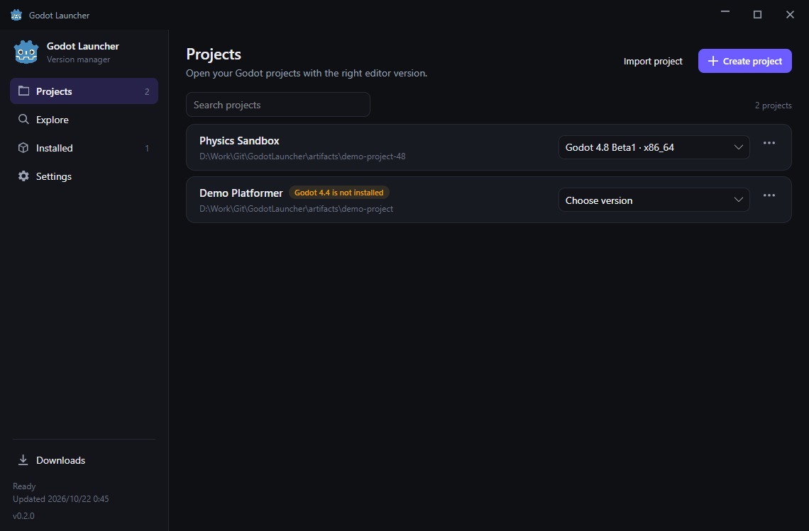
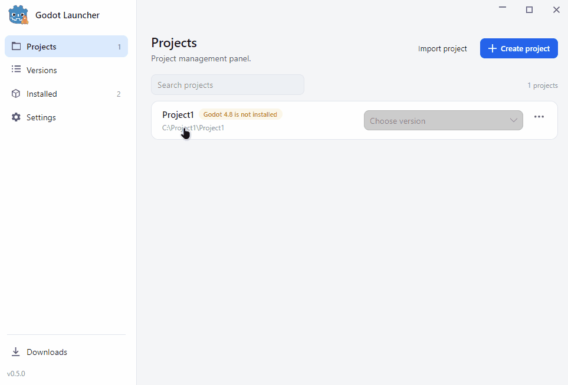

<p align="center">
  ENGLISH | <a href="README.zh-CN.md">中文</a>
</p>

<p align="center">
  <a href="https://github.com/Shaun-Fong/GodotLauncher/actions/workflows/build.yml"></a>
</p>

<p align="center">
A fast, small desktop launcher for <a href="https://godotengine.org/">Godot Engine</a> on Windows, Linux and macOS.
</p>

## Features

- **Project library** — every Godot project you open is remembered with the editor that launched it.
  Create a project from a folder picker, import an existing `project.godot`, pick the engine version per
  project in a dropdown, and open it with one click. A row warns when the engine version a project asks
  for is not installed.
- **Complete release catalog** — stable, RC, beta and dev builds of Godot 4.x, plus 3.x stable. The list
  is cached on disk, rendered before any network call and refreshed in the background every six hours.
  New releases are highlighted with a `NEW` badge, and an in-app banner announces them when the matching
  notification channel is enabled.
- **Offline first** — the cached catalog and the installed editor list are shown immediately, even with
  no network access. Conditional requests (`ETag`/`If-None-Match`) keep refreshes cheap, and a
  truncated upstream catalog is rejected instead of replacing a good cache.
- **Side-by-side installs** — every version lives in its own folder under `editors/std` or `editors/dotnet`.
  Standard and .NET editions, and x86_64, x86_32, ARM64 and ARM32 builds are resolved automatically for
  the current platform.
- **Resumable downloads** — downloads use `.part` files with HTTP range requests, show speed and time
  remaining, can be cancelled, retried and resumed after a restart.
- **Installed editor management** — launch, pin, alias, set a default, edit per-version launch arguments,
  open the install folder, uninstall, clean up old preview builds, or register an editor downloaded by
  hand.
- **Launching** — the editor process is started detached and the launcher hides (configurable) instead
  of blocking. Optional console output uses the `_console.exe` build on Windows.
- **Tray and single instance** — closing the window keeps the launcher in the tray, where the default
  editor and the five most recently used versions are one click away. Starting the launcher again
  focuses the existing window instead of starting a second copy.
- **Themes and localization** — light, dark or system theme with no white flash on startup; English and
  Simplified Chinese out of the box. Adding a language means dropping one JSON file into
  `src/GodotLauncher.App/Localization`.
- **Network options** — follow the system proxy, connect directly, or point the launcher at a custom
  HTTP proxy. Catalog refreshes, downloads and update checks use the same setting, and a failed refresh
  shows a non-blocking hint with a shortcut to the network settings.
- **Launcher updates** — the launcher checks GitHub releases, shows the download speed on the update
  button itself, cancels on a second click, and restarts into the new version as soon as the archive
  is ready. If GitHub's API rate limit is hit, the check falls back to the release page.
- **Portable settings** — human-editable TOML configuration, atomic writes, corrupt files backed up
  instead of crashing.

## Preview



## Download

Prebuilt archives are attached to [releases](https://github.com/Shaun-Fong/GodotLauncher/releases):

| Platform | Archive |
| --- | --- |
| Windows x64 | `GodotLauncher-win-x64.zip` |
| Linux x64 | `GodotLauncher-linux-x64.tar.gz` |
| macOS Intel | `GodotLauncher-osx-x64.tar.gz` |
| macOS Apple silicon | `GodotLauncher-osx-arm64.tar.gz` |

The builds are self-contained: .NET does not have to be installed. Each release also ships
`SHA256SUMS.txt`. The archives are not code signed yet, so Windows SmartScreen and macOS Gatekeeper
may warn on first launch.

## Build from source

Requirements: [.NET 10 SDK](https://dotnet.microsoft.com/download). The Avalonia UI builds on Windows,
Linux and macOS.

```bash
dotnet build GodotLauncher.slnx
dotnet run --project src/GodotLauncher.App
```

Run the tests:

```bash
dotnet test tests/GodotLauncher.Core.Tests/GodotLauncher.Core.Tests.csproj
```

Produce a self-contained single-file build:

```bash
dotnet publish src/GodotLauncher.App/GodotLauncher.App.csproj \
  -c Release -r win-x64 --self-contained true \
  -p:PublishSingleFile=true -p:IncludeNativeLibrariesForSelfExtract=true \
  -p:PublishReadyToRun=true
```

## Command line

| Flag | Description |
| --- | --- |
| `--background` | Start hidden in the tray, used by the autostart entry. |
| `--bench` | Measure cold start to the first frame, write `startup-ms=<n>` to the log and exit. |

## Where things live

| Path | Contents |
| --- | --- |
| `%APPDATA%\GodotLauncher` (Windows) | Data directory |
| `~/Library/Application Support/GodotLauncher` (macOS) | Data directory |
| `$XDG_DATA_HOME/GodotLauncher` (Linux) | Data directory |
| `config.toml` | Settings, created on first save |
| `installed.json` | Installation registry |
| `projects.json` | Project library |
| `catalog-cache.json` | Last known release catalog |
| `logs/launcher.log` | Rolling log, 2 MB × 3 files |
| `editors/<std\|dotnet>/<version-id>/` | Installed editors (configurable) |
| `downloads/`, `.staging/` | In-flight archives and extraction scratch space |

## Status

Version 0.5.0 is the current release. Implemented: release catalog, downloads and installation,
launching, project library, installed editor management, tray, themes, localization, settings, proxy
support, launcher self-update, single instance and optional autostart.

Known gaps are tracked in [docs/DECISIONS.md](docs/DECISIONS.md#known-gaps), including cold start
(~0.9 s instead of the 300 ms target) and checksum verification, which currently only happens when the
publisher digest is known.

## Documentation

- [Architecture](docs/ARCHITECTURE.md) — projects, data flow and storage layout.
- [Decisions](docs/DECISIONS.md) — technology choice, data sources and trade-offs.

## License

[MIT](LICENSE)
